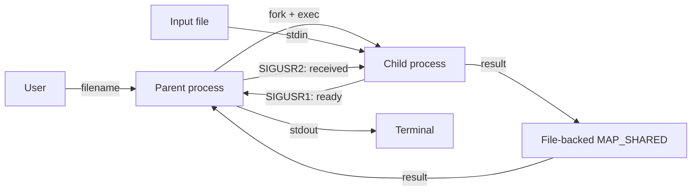

# Лабораторная работа №4

## Вариант 9

Родительский процесс создаёт дочерний процесс. Родитель и ребёнок представлены отдельными программами, как в лабораторной работе №2.

Пользователь вводит имя файла. Родитель открывает файл на чтение и перенаправляет его в стандартный поток ввода дочернего процесса. Дочерний процесс читает строки:

```
число число число ...
```

Все числа имеют тип `float`. Первое число последовательно делится на остальные числа строки.
Результат передаётся родителю через отображаемый файл (`mmap`), после чего родитель выводит его в свой `stdout`.

Пустые строки пропускаются. Строка с одним числом возвращает это число.
При делении на ноль ребёнок сообщает об ошибке в `stderr`, после чего оба процесса завершаются.
Результаты предыдущих строк сохраняются в выводе.
Некорректные числа и выход за диапазон `float` также приводят к завершению.

## Взаимодействие процессов



### Общая память

Родитель создаёт временный файл размером `sizeof(float)` и отображает его в память через `mmap()` с флагом `MAP_SHARED`. Ребёнок наследует дескриптор файла и после `exec` создаёт своё отображение того же файла. Поэтому запись ребёнка в `*shared` видна родителю. Общая область хранит один результат; сигналы передают только уведомления. В конце оба процесса освобождают отображения через `munmap()`.

### Синхронизация

`sigprocmask()` с `SIG_BLOCK` блокирует у родителя `SIGUSR1` и `SIGCHLD`, чтобы их обработчики не выполнились раньше времени. Прежняя маска сохраняется в `wait_mask`, затем эти два сигнала исключаются из неё для ожидания.

Родитель проверяет флаги `result_ready` и `child_finished`. Если событий нет, `sigsuspend()` атомарно устанавливает `wait_mask` и усыпляет родителя, разрешая доставку этих сигналов. Обработчик выставляет соответствующий флаг. После возврата из `sigsuspend()` блокировка восстанавливается. Это предотвращает гонку между проверкой флагов и ожиданием сигнала.

Ребёнок записывает результат в `*shared`, отправляет родителю `SIGUSR1` и ждёт подтверждения через `sigwait()` по заранее заблокированному `SIGUSR2`. Родитель читает число, выводит его и отправляет `SIGUSR2`. Только после подтверждения ребёнок может перезаписать результат. О завершении ребёнка сообщает `SIGCHLD`, а его статус родитель получает через `waitpid()`.

## Сборка из корня

```bash
cmake -S lab_04 -B build/lab_04
cmake --build build/lab_04
```

## Запуск

```bash
cd build/lab_04
./lab4_parent
```

## Отчёт

Исходник отчёта находится в `report/report.tex`, готовый PDF — в `report/report.pdf`.

Для сборки нужен `pdflatex` или `tectonic`:

```bash
cd lab_04/report
make
```
