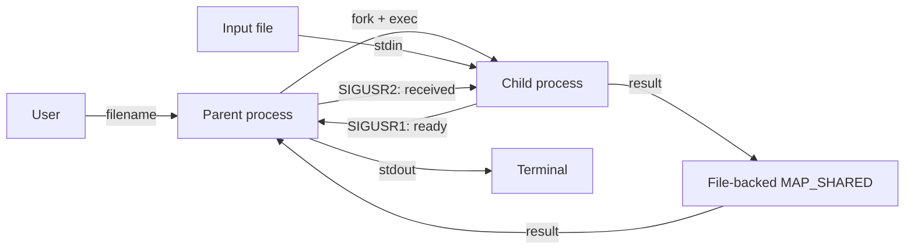

# Лабораторная работа №4

## Вариант 9

Родительский процесс создаёт дочерний процесс. Родитель и ребёнок представлены отдельными программами, как в лабораторной работе №2.

Пользователь вводит имя файла. Родитель открывает файл на чтение и перенаправляет его в стандартный поток ввода дочернего процесса. Дочерний процесс читает строки:

```
число число число ...
```

Все числа имеют тип `float`. Первое число последовательно делится на остальные числа строки.
Результат передаётся родителю через отображаемый файл (`mmap`), после чего родитель выводит его в свой `stdout`.

Пустые строки пропускаются. Строка с одним числом возвращает это число.
При делении на ноль ребёнок сообщает об ошибке в `stderr`, после чего оба процесса завершаются.
Результаты предыдущих строк сохраняются в выводе.
Некорректные числа и выход за диапазон `float` также приводят к завершению.

## Взаимодействие процессов



## Сборка из корня

```bash
cmake -S lab_04 -B build/lab_04
cmake --build build/lab_04
```

## Запуск

```bash
cd build/lab_04
./lab4_parent
```

## Отчёт

Исходник отчёта находится в `report/report.tex`, готовый PDF — в `report/report.pdf`.

Для сборки нужен `pdflatex` или `tectonic`:

```bash
cd lab_04/report
make
```
